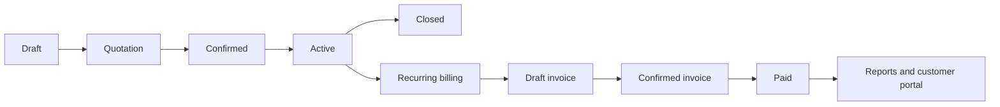
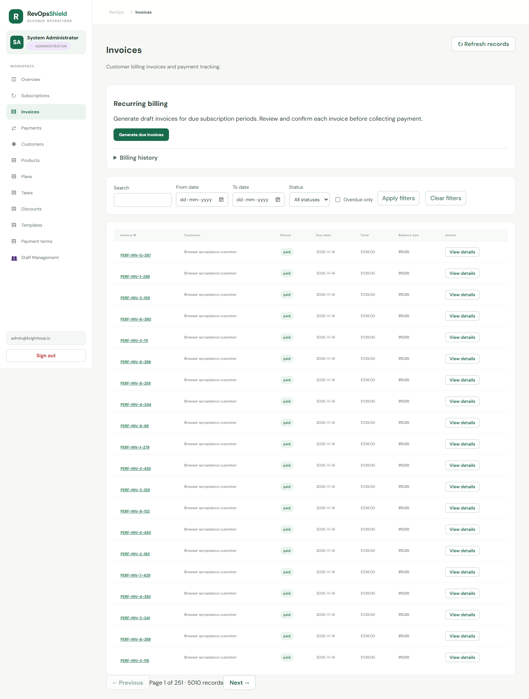
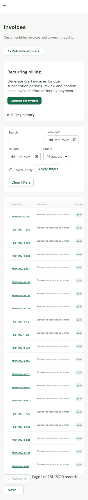
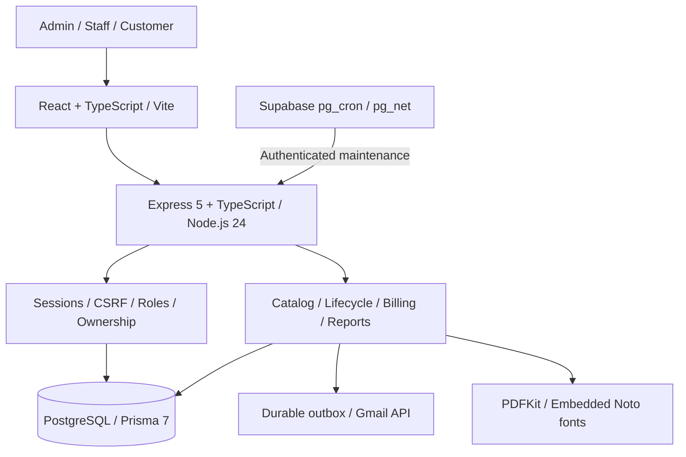

# RevOps Shield

### From quotation to recurring revenue—one connected workspace.

**Built for Brightloop Software's subscription management challenge.** RevOps Shield brings product configuration, subscription lifecycles, recurring invoices, payments and customer visibility into one application. Admins configure the business, staff run daily operations, and customers see their own billing records.

[](https://github.com/Vishnu912py/odoo-hackathon-subscription-management-system/actions/workflows/database-ci.yml)

**[Open the live app](https://brightloop-subscriptions-alpha.vercel.app)** · **[Five-minute demo](#five-minute-demo)** · **[Run locally](#run-locally)** · **[Verification](#tested-beyond-the-happy-path)** · **[API contract](docs/api/openapi.json)**

| Delivered | Evidence |
| --- | --- |
| **75 implemented API operations** | Shared OpenAPI contract, generated frontend types and real authenticated persistence |
| **3 distinct roles** | Administrator, staff and customer; ownership enforced on the server |
| **Complete quotation-to-payment journey** | Verified locally and against hosted Supabase data |
| **Scheduled billing and real email** | Hosted maintenance verified; invitation, invoice and reset messages confirmed in the authorized inbox |
| **5,000+ records in browser testing** | Desktop/mobile acceptance, pagination and measured page navigation |

## The problem we solve

Recurring revenue requires more than generating an invoice. A plan changes, a customer pauses, an invoice needs a retry, a payment arrives in parts—and the numbers still need to agree.

RevOps Shield connects those events through persisted subscription history, explicit lifecycle rules and transactional billing. Staff can trace an invoice back to its subscription, customers get an ownership-scoped portal, and the dashboard reflects recorded invoices and payments.

## Five-minute demo

Open the **[hosted application](https://brightloop-subscriptions-alpha.vercel.app)**. For the administrator/staff walkthrough, use credentials provided by the presenting team. Public signup creates a customer account with its own empty profile; existing billing records are accessed through a verified customer invitation. Hosted administrator credentials are not published in this repository. A complete local demo with synthetic accounts is available below.

| Step | What to show | What it demonstrates |
| --- | --- | --- |
| **1. Configure** | Create a product, tax and recurring plan; optionally add a variant or discount | A configurable catalog and explicit pricing rules |
| **2. Subscribe** | Create a customer and draft subscription; edit its lines, then quote, confirm and activate | A connected workflow with versioned writes and plan-policy checks |
| **3. Bill** | Select **Generate due invoices**, or let the scheduler process the due period | Persisted billing, tax/discount calculation and invoice snapshots |
| **4. Settle** | Confirm the invoice, download its PDF, then record a partial or full payment | Correct outstanding balance and paid status, without a real card charge |
| **5. Verify** | Open Overview, inspect billing history, and view the customer's portal | Reconciled reporting, operational traceability and role-based access |

**Show the difficult case, too:** rerun billing for the same period to demonstrate duplicate protection, or attempt an overpayment to show that the server rejects it. A failed billing period remains recoverable after its underlying issue is repaired.



Pause, resume, renewal, add-ons and early closure follow the plan's policies and recurrence boundaries.

## What you can do

| Area | Implemented capabilities |
| --- | --- |
| **Accounts and access** | Signup, login/logout, password reset, staff management, customer invitations, secure sessions and server-side role/ownership checks |
| **Products and pricing** | Products, variants with price adjustments, add-ons, taxes, fixed/percentage discounts, date windows, thresholds and usage limits |
| **Recurring plans** | Daily, weekly, monthly and yearly billing; minimum quantities; availability dates; pause, renewal and closure policies |
| **Quotations and subscriptions** | Reusable templates, validity periods, draft editing, payment terms, lifecycle transitions and paginated event history |
| **Billing and invoices** | Automatic due-period processing, run history and retry, invoice confirmation/cancellation, email delivery history and PDF download |
| **Payments** | Partial/full receipts with method, date and note; exact balances, overpayment rejection and safe replay of repeated requests |
| **Reporting and portal** | Overview metrics, date/plan filters, searchable paginated records, outstanding/overdue visibility and customer-owned views |
| **Responsive experience** | Desktop and mobile navigation, focused action controls and expandable billing history |

<details>
<summary><strong>See the application: desktop invoice workspace</strong></summary>

Actual browser-acceptance screenshot using synthetic, persisted test records. This is the functional application, not the separate design preview.



</details>

<details>
<summary><strong>See the application: mobile layout</strong></summary>



</details>

## Engineering that protects the numbers

- **One invoice per subscription period.** Database uniqueness, transactional persistence and idempotent requests protect against duplicate billing during retries and concurrent execution.
- **Failure does not advance the billing cursor.** Failed periods stay recoverable. A run can finish with errors, and an administrator can retry after repair.
- **Money stays exact.** PostgreSQL decimal types, decimal-string API fields and explicit rounding preserve financial precision. Concurrent payment requests cannot overpay the same invoice.
- **History stays intact.** Invoices snapshot customer details, line prices, taxes and discounts. Later catalog changes do not rewrite past invoices; retries do not consume a discount twice.
- **Authorization lives on the server.** Hiding a button is not the access boundary. Roles and customer ownership are checked for reads, mutations and PDF downloads.
- **Email has a durable delivery trail.** Encrypted authentication outbox messages, delivery leases and retries support recovery. Invoice delivery is marked sent after provider acceptance.
- **PDFs support Indian-script billing data.** Embedded Noto fonts cover Latin, Devanagari, Bengali, Gurmukhi, Gujarati, Oriya, Tamil, Telugu, Kannada and Malayalam. A multilingual invoice was rendered and visually checked.

## Architecture



| Layer | Implementation |
| --- | --- |
| Frontend | React, TypeScript, Vite; generated types from the shared contract |
| Backend | Node.js 24, Express 5, TypeScript, OpenAPI 3.1 validation |
| Persistence | PostgreSQL, Prisma ORM/Migrate 7.10.1, database constraints and transactions |
| Hosting | Vercel frontend/API services; Supabase PostgreSQL in Mumbai |
| Scheduling | Hosted billing maintenance every minute; local development worker every 30 seconds |
| Delivery | Gmail API with OAuth, persistent outboxes and retries; PDFKit for invoice PDFs |
| CI | GitHub Actions with PostgreSQL 16, migrations, repeatable seeding, constraint/integration tests and frontend checks |

The browser never connects directly to the database. Hosted data lives in a private schema with a dedicated backend role, restricted API-role privileges and certificate-verified database connections. Maintenance endpoints require a bearer secret stored in Supabase Vault for the hosted schedule.

## Tested beyond the happy path

Recorded verification as of **31 October 2026**:

| Check | Result |
| --- | --- |
| Backend validation | **17 tests passed**, plus Prisma validation/generation, TypeScript and compilation |
| Frontend validation | **33 tests passed**, plus generated contract types, lint and production build |
| Real PostgreSQL integration | **21 tests passed** in temporary isolated schemas, including enclosing tests |
| Final V3 run with browser acceptance | **12 checks passed**, including desktop/mobile interaction and the 5,000-record workload |
| OpenAPI validation | **75 operations, 111 schemas, 10 valid examples and 8 rejected invalid payloads** |
| Hosted acceptance | Catalog → customer → quotation → activation → billing → confirmation → payment → PDF → report verified against persisted data |
| Real delivery | Customer invitation, invoice and password-reset emails confirmed received; invitation acceptance and owned invoice access verified |

The suites above overlap; their counts are not a total of unique tests. Coverage includes cross-customer access rejection, duplicate payment replay, concurrent overpayment attempts, discount usage protection, billing recovery, late activation, calendar recurrence and mobile navigation. Test records are synthetic; temporary integration schemas are removed after the tests.

### Measured page navigation with thousands of records

The latest UI-cleanup browser run contained **5,012 subscriptions and 5,010 invoices**, including copied line, tax and payment records. Five authenticated navigation measurements were taken per page:

| Page | Observed range | Slowest sample |
| --- | --- | --- |
| Overview | 214–309 ms | **309 ms** |
| Subscriptions | 150–172 ms | **172 ms** |
| Invoices | 138–260 ms | **260 ms** |

Measured from navigation click until loaded content rendered on Windows, AMD Ryzen AI 5 340, local PostgreSQL, Node.js 24, Vite and headless Edge, without CPU/network throttling. These samples meet the two-second target for the measured local pages; they are **not a hosted cold-start or concurrent-load benchmark**. No browser JavaScript errors were reported. See the [verification guide](docs/integrated-product.md) for methodology and repeat instructions.

## Run locally

**Prerequisites:** Node.js **24.x**, npm and a running PostgreSQL instance. Use a dedicated development database for the synthetic demo.

```bash
git clone https://github.com/Vishnu912py/odoo-hackathon-subscription-management-system.git
cd odoo-hackathon-subscription-management-system
npm --prefix backend ci
npm --prefix frontend ci
```

Copy `backend/.env.example` to `backend/.env` without overwriting an existing configuration. Set `DATABASE_URL` to your development database and keep `FRONTEND_ORIGIN=http://localhost:5173`.

```bash
npm --prefix backend run db:deploy
npm --prefix backend run prisma:generate
```

For a synthetic demo, set `ALLOW_DEV_SEED=true` in that development `.env`, then run:

```bash
npm --prefix backend run prisma:seed
npm run dev
```

Open **http://localhost:5173**. The root development command starts the frontend, API and billing worker together.

<details>
<summary><strong>Local demo accounts</strong> — disposable development database only</summary>

| Email | Role |
| --- | --- |
| `admin@brightloop.io` | Administrator |
| `staff@brightloop.io` | Staff |
| `billing@acmestudio.com` | Customer |

Default local password: `BrightloopDemo!2026`. Set `DEMO_PASSWORD` before the first seed to choose another. These are not hosted administrator credentials. Repeated seeding preserves existing passwords, balances and record values; it does not reset a completed demo.

The seeded reporting example uses October 2026 dates. Select that range when inspecting its historical invoices and payments. See [local fixture details](docs/prototype-v1.md#development-accounts-and-demo).

</details>

For an unseeded installation, create the first administrator with `npm --prefix backend run admin:create` after setting `ADMIN_BOOTSTRAP_EMAIL` and a valid `ADMIN_BOOTSTRAP_PASSWORD` in the operator environment. Remove those bootstrap values afterward.

Email features require the Gmail OAuth and encryption settings in `backend/.env.example`; they are not simulated when configuration is missing. See [backend setup](backend/README.md) and [deployment/worker operation](docs/integrated-product.md).

### Validation commands

```bash
npm run check                         # Backend + frontend checks
npm run test:integration              # Real PostgreSQL HTTP integration
npm --prefix backend run test:db      # Database constraint checks
npm run build                        # Compile both applications
```

The rendered browser suite is opt-in and requires Playwright/Edge and a test Vite proxy. Follow the [browser verification instructions](docs/integrated-product.md#local-page-timing-sample).

## Repository map

```text
frontend/                 React application, role-aware workflows and generated API types
backend/
  prisma/                 Authoritative schema, migrations and synthetic seed
  src/modules/            Accounts, catalog, lifecycle, billing and reporting
  scripts/                Workers, operator tools and database verification
  test/                   Unit, PostgreSQL integration and browser acceptance
docs/
  api/                    OpenAPI contract, generator, examples and validator
  images/                 Screenshots from the functional browser acceptance run
  integrated-product.md   Current operation and verification guide
.github/workflows/        PostgreSQL-backed continuous integration
```

## Team

| Contributor | Responsibility |
| --- | --- |
| [Vishnu912py](https://github.com/Vishnu912py) | Team lead; architecture, backend behavior, authentication, lifecycle, integration and release |
| [Zenfox-690](https://github.com/Zenfox-690) | Domain modeling, schema/migrations, transactional persistence, reporting queries and database integrity |
| [albinsavi123-lang](https://github.com/albinsavi123-lang) | Admin/staff interfaces, customer portal, responsive layouts and dashboard presentation |

## Scope and useful references

This implementation uses **INR** and the **Asia/Kolkata** business timezone. Payments record receipts; they do not charge cards or transfer funds. Live payment gateways, refunds, multi-currency and advanced revenue recognition are outside this MVP. Free hosting limits apply; Vercel Services is a beta platform capability. Email retries provide durable recovery, but an ambiguous provider response can still produce a duplicate message.

- [Current product operation and verification](docs/integrated-product.md)
- [Challenge requirements and acceptance criteria](docs/requirements.md)
- [Shared API contracts](docs/api-contracts.md) and [OpenAPI specification](docs/api/openapi.json)
- [Data model and ER diagram](docs/er-diagram.md)
- [Billing persistence handoff](docs/database-persistence-handoff.md) and [reporting handoff](docs/reporting-persistence-handoff.md)

<a id="foundation-checklist--31-october-2026"></a>

Earlier prototype documents and planning checklists describe historical increments. The [current product guide](docs/integrated-product.md) and this README supersede their implementation-status notes; the original team checklist remains available in Git history.
