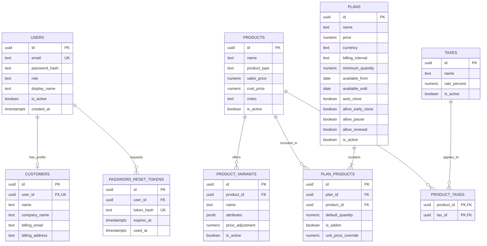
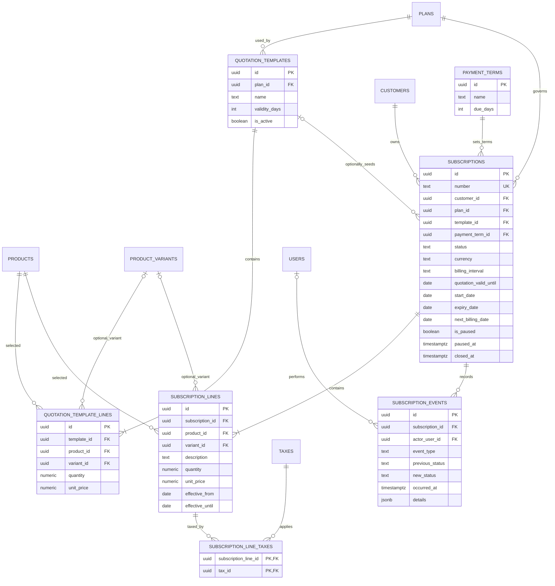
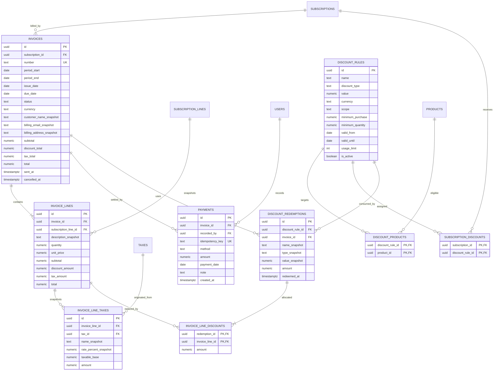

# ER diagram and schema handoff

Owner: **Zenfox-690**. Backend integration/reviewer: **Vishnu912py**. Frontend consumer: **albinsavi123-lang**.

Implementation update: the newer [API contract guide](api-contracts.md) resolves earlier open policies with proposed MVP defaults and adds persistence requirements in section 8 (versions, sessions, idempotency, jobs, snapshots and effective scheduling). Use it alongside this logical ER model. In particular, explicit included-line pricing replaces the allocation proposal below, and API expiry dates are exclusive. Do not assume the original diagram alone covers every infrastructure table.

Design baseline: the React/Express/PostgreSQL stack discussed with Vishnu. This is a proposed logical schema, not an applied migration. Versions, hosting and business-policy defaults still need agreement. It covers [R01-R12](requirements.md); diagrams use Mermaid and render on GitHub. `PK` = primary key, `FK` = foreign key, `UK` = unique key. A circle means optional, a crow's foot means many. Repeated entities across diagrams refer to the same table.

## 1. Accounts, catalog and plans

Customer profiles may exist before signup (staff-created customers), so `customers.user_id` is nullable and unique when present. One customer login owns at most one profile in this MVP; multiple contacts per company are deferred. `users.role` is `admin`, `staff` or `customer`. Staff creation and role changes require server-side admin authorization. Normalize email consistently and enforce case-insensitive uniqueness in PostgreSQL. Store only password hashes and hashed reset tokens; reset tokens expire and are single-use.

A variant row represents one selectable combination (for example `{"brand":"Odoo"}` with +560), not one row per attribute. Subscription lines may omit a variant. `plan_products` lists included products and optional add-ons; adding an add-on creates a subscription line rather than a new subscription. Product type values must be agreed before adding an enum.

**Pricing decision to settle before billing:** how plan price is distributed across included product lines. Do not add `plans.price` to the sum of lines automatically, which could double charge. Proposed rule: plan price is the default bundle price, allocated to included lines when a quotation is created; add-ons are priced separately. Persist final agreed prices on subscription lines. Zenfox can create the tables while Vishnu finalizes allocation and rounding examples.

## 2. Quotations and subscription lifecycle

**A quotation is a subscription in `quotation` status**, not a duplicate customer agreement in another table. The template is copied, so later template edits do not change existing quotations. Status values preserve the statement: `draft`, `quotation`, `confirmed`, `active`, `closed`. Pause is an orthogonal flag allowed only for active subscriptions under plan policy. Events record pause/resume, renewal, closure and status changes; null actor means a scheduled system action. Renewal extends the same subscription in this proposed MVP, retaining its number and recording old/new dates in events.

Snapshot recurrence/currency onto the subscription at agreement time. Define whether later plan-policy edits affect existing subscriptions before implementing policy checks. Quantities are positive. `effective_until` is exclusive and nullable; retain old lines when an add-on is disabled or its price changes so historical catch-up billing uses the correct terms. Proposed MVP changes take effect at billing-period boundaries; mid-period proration is deferred, not silently calculated. Transactions must reject overlapping versions of the same logical line if versioning is implemented.

The `|{` cardinalities express a business requirement for nonempty templates/plans/subscriptions when published or confirmed. A plain FK cannot enforce a minimum child count; backend validation must allow incomplete drafts and reject confirmation without lines.

## 3. Billing, discounts and payments

Customer ownership of an invoice is derived through its subscription, avoiding a second inconsistent customer FK. Historical billing details are snapshots. Do not move a subscription with invoices to another customer. Product descriptions, variant details (in description), prices, tax rates and applied discounts remain unchanged after invoice confirmation.

Proposed discount semantics: `scope` is `product` or `subscription`; product rules automatically target matching `discount_products`, while subscription rules are explicitly assigned using `subscription_discounts`. Eligibility is checked on each billing date. A rule consumes **one use per invoice**, regardless of the number of discounted lines. Redemptions record that use; line allocations preserve exact tax bases. Whether multiple eligible rules may stack, and how thresholds are measured, remains a team decision. Do not implement arbitrary stacking defaults.

`payments` supports multiple partial payments against one invoice, each with its own method/date/note. Amounts use the invoice currency. Payment methods are recorded labels, not gateway integrations. Proposed MVP rejects overpayments; if refunds/reversals are later added, model them explicitly rather than deleting payment history. Invoice status is `draft`, `confirmed`, `paid`, or `cancelled`; overdue is derived from due date and unpaid balance, not a separate stored status.

## PostgreSQL implementation checklist

Use UUID IDs; `numeric(18,2)` for final money, `numeric(18,4)` for unit prices/quantities and `numeric(7,4)` for percentage rates. These precisions assume a two-decimal settlement currency; confirm currency and rounding before migrations are finalized. Use `date` for billing/calendar boundaries and `timestamptz` for event/audit times. Add `created_at`/`updated_at` to mutable parent entities even where omitted for diagram readability. Required fields are `NOT NULL`; optional fields are explicitly identified below.

| Area | Constraint or implementation rule |
| --- | --- |
| Optional columns | Customer `user_id`, company/address; reset `used_at`; product notes; plan availability bounds; line variant; plan-product price override; subscription template, quote validity, expiry, next bill while draft, pause/closure times; line end date; event actor/previous/new status; invoice sent/cancelled times; discount thresholds, bounds, usage limit, and currency for percentage rules; payment note. Others required unless a documented draft workflow needs nulls. |
| Uniqueness | Case-insensitive user email; subscription/invoice number; token hash; payment idempotency key; `(plan_id, product_id)`; all bridge composite PKs; `(discount_rule_id, invoice_id)` redemption; `(invoice_line_id, tax_id)` tax snapshot. |
| Billing identity | Proposed one recurring invoice per subscription and period: unique `(subscription_id, period_start)` with `period_end > period_start`. Periods are half-open `[start, end)`. Reject overlapping periods in service or a database exclusion constraint; a unique start alone does not prevent overlaps. |
| Variant ownership | Add unique `(product_id, id)` on variants and composite FKs `(product_id, variant_id)` from template/subscription lines. This prevents selecting another product's variant. |
| Snapshot ownership | Ensure an invoice line's subscription line belongs to the invoice's subscription. Ensure every line discount allocation belongs to its redemption's invoice. These require a trigger, additional composite FKs, or checked transactional service operations; independent FKs alone are insufficient. |
| Values | Positive quantities/payment amounts; nonnegative prices/totals/thresholds; percentage values 0-100; fixed discount > 0; nonnegative tax rate; due/validity days >= 0; usage limit null (unlimited) or > 0; ordered date bounds. Negative variant adjustments permitted only when resulting unit price stays nonnegative. |
| Lifecycle | Only valid status transitions; pause only active; plan policies gate actions. Required dates and at least one eligible line checked before confirmation. Customer ownership/roles enforced on server. |
| Financial totals | Sum line subtotals, discount allocations and taxes into invoice totals in one transaction; total = subtotal - discount + tax; discounts cannot exceed eligible base. Cross-row sums require service/trigger checks, not simple row CHECK constraints. |
| Deletion | Archive products/plans/rules/users with active flags; RESTRICT deletion of referenced subscriptions, invoices, lines, taxes, rules and payments. Cascade only disposable reset tokens or unreferenced draft children under controlled deletion. |
| Indexes | FK lookup columns, subscriptions `(customer_id, status)` and `(status, next_billing_date)`, invoices `(status, due_date)` and `(subscription_id, issue_date)`, payments `(invoice_id, payment_date)`, events `(subscription_id, occurred_at)`. Unique constraints already create indexes; avoid duplicates. |

### Billing transaction contract with Vishnu

1. Lock the subscription row and read the next due period; skip closed/paused/ineligible subscriptions under the agreed policy.
2. Find an existing invoice by period identity before allocating a new number. A retry must reuse its result, not create another invoice.
3. Select historically applicable subscription lines. Lock eligible discount-rule rows in a consistent ID order; count persisted redemptions and check usage caps while locked.
4. Insert invoice, immutable line/tax snapshots, redemptions and allocations. Advance `next_billing_date` in the same transaction. Roll back all changes on failure.
5. Repeat missed periods in order, using month/year calendar arithmetic with an agreed month-end anchor, not fixed 30/365-day intervals.
6. Send invoice emails after commit; retry delivery separately. `sent_at` is delivery bookkeeping, not invoice identity. A reliable delivery queue/outbox can be added during implementation.

Recording a payment locks the invoice, checks the idempotency key, verifies remaining balance, inserts the payment and updates paid status atomically. A repeated key with different contents is rejected. Payments on draft/cancelled invoices are rejected in this proposed MVP.

**Before finalizing cancellation:** choose whether a cancelled billing period can be rebilled and whether discount usage is restored. The proposed unique billing identity reserves cancelled periods too; never delete a cancelled invoice to bypass it. If rebilling is required, extend the model with explicit replacement/version relationships. This and tax order, discount stacking, plan-price allocation and pause/renewal calendar rules are business decisions for Vishnu, not assumptions Zenfox should guess.

## Schema creation order and checks

1. Users, customers, tokens, products, variants, plans, taxes and payment terms.
2. Catalog bridges, templates and template lines.
3. Subscriptions, lines, tax assignments and events.
4. Invoices, lines, tax snapshots and payments.
5. Discount rules, target/assignment bridges, redemptions and allocations.

Seed an admin, staff, two customers, a product with +560 variant, monthly/yearly plans, a quotation template, a tax and both fixed/percentage discounts. Verify duplicate emails/numbers, wrong-product variants and invalid foreign keys fail; customer isolation works through the API; two billing workers create one period invoice; two final discount uses cannot exceed the cap; repeated payment submissions do not duplicate money; partial payment leaves a balance; confirmed snapshots survive price/rule edits. Reports are queries/views over these records, not a manually updated dashboard table.

Next deliverable from Zenfox: migrations plus seed fixtures and a short note resolving any differences from this diagram with Vishnu. This file specifies structure and handoffs; it does not create the database.
