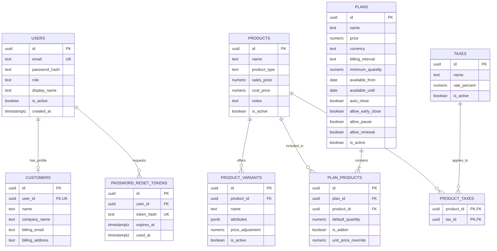
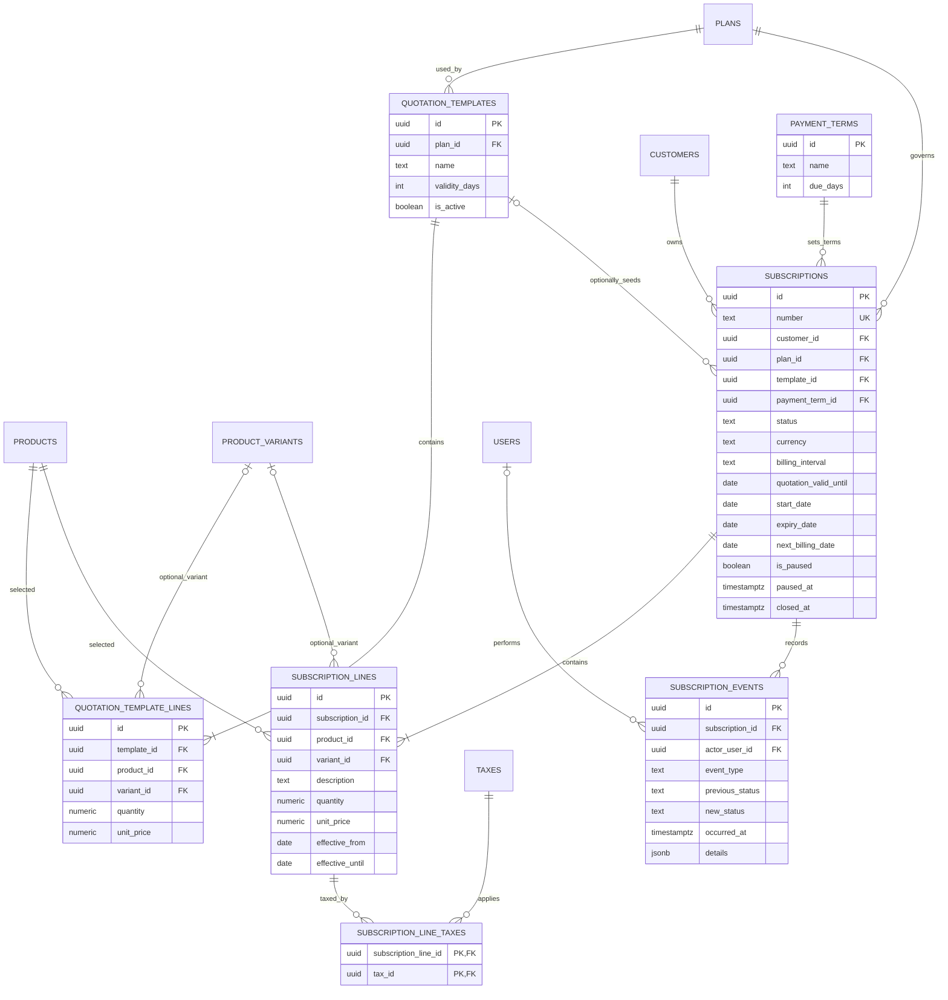
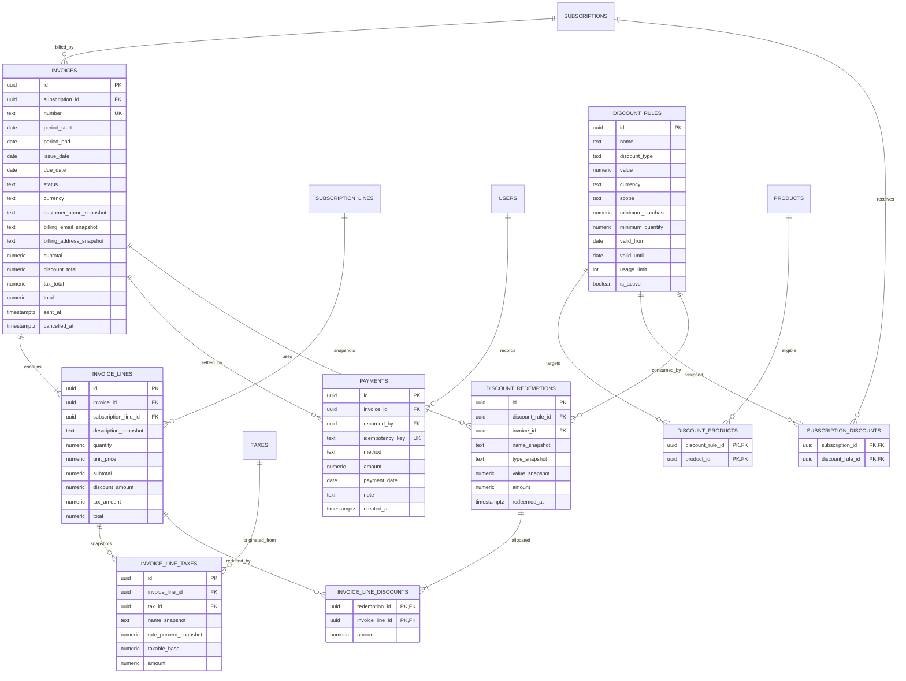
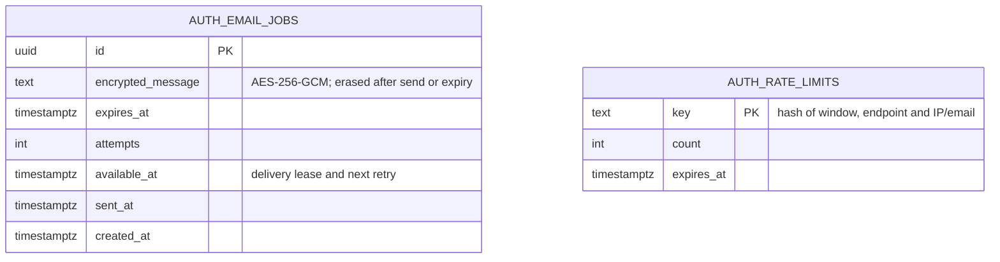

# ER diagram and schema handoff

Owner: **Zenfox-690**. Backend integration/reviewer: **Vishnu912py**. Frontend consumer: **albinsavi123-lang**.

Implementation update: the newer [API contract guide](api-contracts.md) resolves earlier open policies with proposed MVP defaults and adds persistence requirements in section 8 (versions, sessions, idempotency, jobs, snapshots and effective scheduling). Use it alongside this logical ER model. In particular, explicit included-line pricing replaces the allocation proposal below, and API expiry dates are exclusive. Do not assume the original diagram alone covers every infrastructure table.

Design baseline: the React/Express/PostgreSQL stack agreed with Vishnu. This is a refined logical schema and integrity specification, not an applied migration. It covers [R01-R12](requirements.md); diagrams use Mermaid and render on GitHub. `PK` = primary key, `FK` = foreign key, `UK` = unique key. A circle means optional, a crow's foot means many. Repeated entities across diagrams refer to the same table.

## 1. Accounts, catalog and plans

### Account, catalog and plan integrity rules

- **Email uniqueness:** User email addresses must be unique regardless of case. Standard PostgreSQL `UNIQUE` constraints are case-sensitive; enforce case-insensitivity via a functional unique index: `CREATE UNIQUE INDEX users_email_lower_idx ON users (LOWER(email));` (or PostgreSQL `citext`). Prisma's `@unique` creates a standard index and does not natively model functional expressions; this constraint requires a custom SQL migration script.
- **Customer linkage:** `customers.user_id` is nullable and unique when present (`UNIQUE (user_id)`). This permits staff to create customer billing profiles before customer self-registration. A user login links to at most one customer profile in v1.
- **Product variant ownership:** A variant row represents one selectable combination with an adjustment (e.g. `{"brand":"Odoo"}` with +560). To prevent quotation or subscription lines from referencing a variant belonging to an unrelated product, define a composite unique constraint `UNIQUE (id, product_id)` on `product_variants`. Downstream line tables reference this composite key using `(variant_id, product_id)`.
- **Monetary precision:** All monetary values use exact PostgreSQL numeric types:
  - Catalog sales and cost prices: `NUMERIC(18,4)`
  - Variant adjustments: `NUMERIC(18,4)`
  - Plan prices: `NUMERIC(18,2)`
  - Quantities: `NUMERIC(18,4)`
  - Tax rates: `NUMERIC(7,4)` (percentage points, e.g. `18.0000` for 18%)
  - Floating-point types (`FLOAT`, `DOUBLE PRECISION`, `REAL`) are strictly prohibited to prevent decimal drift. Currency (baseline INR) and rounding conventions must be agreed before applying migrations.
- **Row-level CHECK constraints:**
  - `CHECK (sales_price >= 0)` and `CHECK (cost_price >= 0)` on `products`.
  - `CHECK (price >= 0)` and `CHECK (minimum_quantity > 0)` on `plans`.
  - `CHECK (available_until IS NULL OR available_until >= available_from)` on `plans`.
  - `CHECK (default_quantity > 0)` on `plan_products`.
  - `CHECK (unit_price_override IS NULL OR unit_price_override >= 0)` on `plan_products`.
  - `CHECK (rate_percent >= 0 AND rate_percent <= 100)` on `taxes`.
- **Cross-row pricing constraints:** A negative variant `price_adjustment` is allowed only if `product.sales_price + price_adjustment >= 0`. This cross-table rule cannot be evaluated in a single-row CHECK constraint; it must be enforced in transactional service validation and database triggers.
- **Plan pricing vs line items:** `plans.price` represents the default bundled price. The v1 API contracts propose explicit included-line pricing (the sum of default included-product line amounts equals `plans.price`), while add-ons are priced separately.

## 2. Quotations and subscription lifecycle

### Lifecycle and contract integrity rules

- **Quotations as subscription status:** A quotation is a subscription in `quotation` status, avoiding duplicate customer-agreement models. The formal lifecycle preserves the problem statement: `draft -> quotation -> confirmed -> active -> closed`.
- **Variant ownership enforcement:**
  - `quotation_template_lines` includes composite foreign key `(variant_id, product_id) REFERENCES product_variants(id, product_id)`.
  - `subscription_lines` includes composite foreign key `(variant_id, product_id) REFERENCES product_variants(id, product_id)`.
  - Because `variant_id` is nullable (for base products without variants), PostgreSQL composite FK validation under standard `MATCH SIMPLE` verifies product ownership whenever `variant_id IS NOT NULL`.
- **Plan and policy snapshotting:**
  - The model snapshots `currency` and `billing_interval` onto `subscriptions` at creation.
  - *Snapshotting recommendation:* Plan policies (`auto_close`, `allow_early_close`, `allow_pause`, `allow_renewal`) and payment term `due_days` must be snapshotted onto the subscription at `confirmed` time. If an administrator later alters plan policy flags or payment terms in the catalog, existing active contracts must not be retroactively altered.
  - *Unresolved decision:* Vishnu must confirm whether policy flags are snapshotted onto columns in `subscriptions` or versioned via explicit contract revisions.
- **Monetary precision:**
  - Line unit prices: `NUMERIC(18,4)`
  - Line quantities: `NUMERIC(18,4)`
- **Row-level CHECK constraints:**
  - `CHECK (validity_days > 0)` on `quotation_templates`.
  - `CHECK (quantity > 0)` and `CHECK (unit_price >= 0)` on `quotation_template_lines`.
  - `CHECK (due_days >= 0)` on `payment_terms`.
  - `CHECK (expiry_date IS NULL OR expiry_date >= start_date)` on `subscriptions`.
  - `CHECK (quantity > 0)` and `CHECK (unit_price >= 0)` on `subscription_lines`.
  - `CHECK (effective_until IS NULL OR effective_until > effective_from)` on `subscription_lines`.
- **Pause and renewal semantics:**
  - `is_paused` is a boolean flag reflecting active state at business today. Effective pause intervals take effect at not-yet-started recurrence boundaries. Pausing skips period generation during the pause interval without shifting the recurrence anchor.
  - Renewal extends `expiry_date` to a later aligned billing boundary for active subscriptions where plan policy permits renewal; closed records cannot be reopened.
- **Empty child cardinalities:** The `|{` Mermaid cardinalities express business requirements for nonempty lines when confirming quotations or activating subscriptions. Plain foreign keys cannot enforce child count minimums; service layer validation rejects confirmation without active lines.

## 3. Billing, discounts and payments

### Billing, payment and discount integrity rules

- **Billing-period integrity:**
  - Proposed uniqueness constraint: `UNIQUE (subscription_id, period_start)`.
  - Row CHECK constraint: `CHECK (period_end > period_start)`.
  - Canonical periods begin on `period_start` and end exclusively at the next calendar recurrence boundary. Transaction locking (`SELECT ... FOR UPDATE` on the subscription row) and sequential period generation guarantee that concurrent workers cannot create duplicate invoices for the same period.
  - *PostgreSQL GiST exclusion constraint:* A range exclusion constraint (`EXCLUDE USING gist (subscription_id WITH =, daterange(period_start, period_end, '[)') WITH &&)`) provides an engine-level guarantee against arbitrary overlapping periods. Because periods are strictly generated from canonical calendar anchors and serialized per subscription, this exclusion constraint is not added automatically; it is documented as an additional safeguard if arbitrary non-canonical period ranges are permitted in the future.
- **Cancellation and rebilling (unresolved business decision):**
  - If an invoice is cancelled, the consequences depend on the rebilling policy:
    1. *Reserving cancelled periods:* The unique constraint `UNIQUE (subscription_id, period_start)` permanently locks the cancelled period from ever being billed again. This prevents accidental duplicate billing and maintains strict audit history, but prevents re-issuing a corrected invoice for the same period.
    2. *Allowing rebilling via partial unique index:* Using `CREATE UNIQUE INDEX idx_invoices_active_period ON invoices (subscription_id, period_start) WHERE status != 'cancelled';` permits generating a new invoice for that period after cancellation. However, this produces multiple invoice records for the same period, complicating historical accounting reconciliation.
    3. *Explicit replacement / revision records:* Modeling an explicit `replaced_by_invoice_id` foreign key or `revision_number` tracks corrections without violating period identity.
  - This decision requires confirmation from Vishnu before final migration authoring.
- **Payment integrity:**
  - Payment idempotency is mandatory: `idempotency_key` is unique (`UNIQUE (idempotency_key)`). Submitting the same key returns the existing payment record without duplicating balance reductions.
  - Multiple partial payments are supported against a single invoice (1:N relationship).
  - Overpayment prevention: The proposed policy strictly forbids overpayment (`SUM(payments.amount) <= invoice.total`). Submitting a payment exceeding the unpaid balance returns an error. This policy is subject to Vishnu's approval.
  - Atomic payment persistence: Payment insertion, invoice balance reduction, aggregate version increment, and transition to `PAID` (when balance reaches 0) execute within a single atomic database transaction with row-level locks on `invoices`.
- **Discount integrity:**
  - One redemption per invoice: A discount rule cannot be consumed more than once on the same invoice, enforced by `UNIQUE (discount_rule_id, invoice_id)` on `discount_redemptions`.
  - Usage caps: Rules with a finite `usage_limit` are protected against race conditions by locking the `discount_rules` row (`SELECT ... FOR UPDATE`) during billing generation, verifying `COUNT(redemptions) < usage_limit` before inserting the redemption.
  - Allocations: Discount allocations cannot exceed the eligible line subtotal: `invoice_line_discounts.amount <= invoice_lines.subtotal`.
  - Immutability: Historical invoice line discounts and tax snapshots remain completely immutable once created.
- **Monetary precision:**
  - Invoice header subtotals, discounts, taxes, and totals: `NUMERIC(18,2)`
  - Invoice line amounts: `NUMERIC(18,2)`
  - Invoice line unit prices and quantities: `NUMERIC(18,4)`
  - Tax snapshot rates: `NUMERIC(7,4)`
  - Tax taxable base and amount: `NUMERIC(18,2)`
  - Discount values: `NUMERIC(18,4)` (or `NUMERIC(7,4)` when percentage)
  - Payment amounts: `NUMERIC(18,2)`
- **Row-level CHECK constraints:**
  - `CHECK (period_end > period_start)` on `invoices`.
  - `CHECK (subtotal >= 0 AND discount_total >= 0 AND tax_total >= 0 AND total >= 0)` on `invoices`.
  - `CHECK (quantity > 0)` and `CHECK (unit_price >= 0)` on `invoice_lines`.
  - `CHECK (subtotal >= 0 AND discount_amount >= 0 AND tax_amount >= 0 AND total >= 0)` on `invoice_lines`.
  - `CHECK (rate_percent_snapshot >= 0 AND rate_percent_snapshot <= 100)` on `invoice_line_taxes`.
  - `CHECK (taxable_base >= 0 AND amount >= 0)` on `invoice_line_taxes`.
  - `CHECK (value > 0)` on `discount_rules`.
  - `CHECK (minimum_purchase IS NULL OR minimum_purchase >= 0)` on `discount_rules`.
  - `CHECK (minimum_quantity IS NULL OR minimum_quantity > 0)` on `discount_rules`.
  - `CHECK (valid_until IS NULL OR valid_until >= valid_from)` on `discount_rules`.
  - `CHECK (usage_limit IS NULL OR usage_limit > 0)` on `discount_rules`.
  - `CHECK (amount >= 0)` on `discount_redemptions`.
  - `CHECK (amount >= 0)` on `invoice_line_discounts`.
  - `CHECK (amount > 0)` on `payments`.

## 4. PostgreSQL implementation checklist

Use UUID primary keys; `numeric(18,2)` for settlement money and totals, `numeric(18,4)` for unit prices/quantities and `numeric(7,4)` for percentage rates. Use `date` for calendar boundaries and `timestamptz` for timestamps. Required fields are `NOT NULL`; optional fields are explicitly documented below.

| Area | Constraint or implementation rule |
| --- | --- |
| Optional columns | Customer `user_id`, company/address; reset `used_at`; product notes; plan availability bounds; line variant; plan-product price override; subscription template, quote validity, expiry, next bill while draft, pause/closure times; line end date; event actor/previous/new status; invoice sent/cancelled times; discount thresholds, bounds, usage limit, and currency for percentage rules; payment note. |
| Uniqueness | Functional index on `LOWER(email)` on `users`; subscription `number`; invoice `number`; reset `token_hash`; payment `idempotency_key`; `(plan_id, product_id)` on `plan_products`; `(id, product_id)` on `product_variants`; `(subscription_id, period_start)` on `invoices`; `(discount_rule_id, invoice_id)` on `discount_redemptions`; all bridge composite PKs. |
| Variant ownership | Composite foreign keys `(variant_id, product_id) REFERENCES product_variants(id, product_id)` on `quotation_template_lines` and `subscription_lines`. |
| Billing identity | Unique `(subscription_id, period_start)` with `period_end > period_start`. Row locking on subscriptions serializes billing runs and prevents duplicate period generation. Optional GiST exclusion constraint reserved as safeguard if non-canonical overlapping periods are permitted. |
| CHECK constraints | Quantities > 0; payment amount > 0; discount value > 0; prices, subtotals, totals, and balances >= 0; tax rates 0–100; valid date bounds (`period_end > period_start`, `expiry_date >= start_date`, `valid_until >= valid_from`, `available_until >= available_from`). |
| Financial totals | Cross-row balance equations (`total = subtotal - discount_total + tax_total`; `line.total = subtotal - discount_amount + tax_amount`) enforced via transactional service logic and database triggers. |
| Referential integrity | Archive records using `is_active = false`; enforce `ON DELETE RESTRICT` on referenced subscriptions, invoices, lines, taxes, rules, and payments. Cascade only disposable reset tokens or unconfirmed draft children under controlled deletion. |
| Performance indexes | Explicit targeted indexes (avoiding redundant indexes created by unique constraints): • Subscriptions: `(customer_id, status)` • Billing scheduler: `CREATE INDEX idx_subscriptions_billing_due ON subscriptions (next_billing_date) WHERE status = 'active' AND is_paused = false;` • Collections / Overdue: `CREATE INDEX idx_invoices_outstanding ON invoices (due_date) WHERE status = 'confirmed';` • Subscriptions to invoices: `(subscription_id, issue_date DESC)` • Payments by invoice: `(invoice_id, payment_date DESC)` • Subscription audit: `(subscription_id, occurred_at DESC)` |

### Billing transaction contract with Vishnu

1. Lock the subscription row (`SELECT ... FOR UPDATE`) and determine the next due period; skip closed, paused, or ineligible subscriptions under the agreed policy.
2. Query existing invoices by `(subscription_id, period_start)` before allocating an invoice number. Network retries must reuse the existing invoice rather than creating duplicates.
3. Select historically active subscription lines (`effective_from <= period_start AND (effective_until IS NULL OR effective_until > period_start)`). Lock eligible discount rules in stable UUID order; verify usage caps while locked.
4. Insert the invoice, immutable line snapshots, tax snapshots, redemptions, and line discount allocations. Advance `next_billing_date` in the same transaction. Roll back all changes on any failure.
5. Process historical missed periods sequentially using month/year calendar arithmetic with an agreed month-end anchor, never fixed 30/365-day intervals.
6. Dispatch invoice delivery emails asynchronously after commit; delivery retries operate independently of invoice generation.

### Payment transaction contract with Vishnu

1. Lock the target invoice row (`SELECT ... FOR UPDATE`) and verify status is `confirmed`.
2. Check `idempotency_key` against `payments`. A retry with matching parameters returns the existing payment; conflicting parameters return 409 conflict.
3. Verify that `payment.amount <= (invoice.total - amount_paid)` under the proposed overpayment prevention rule.
4. Insert the payment record, update invoice paid amount, increment invoice aggregate `version`, update invoice status to `paid` if remaining balance is zero, and commit atomically.

---

## 5. Unresolved decisions for Vishnu's confirmation

The following business policies must be confirmed by the team lead before finalizing migrations and persistence services:

1. **Plan-price allocation and line totals:** Confirm whether `plans.price` is an advertised bundle price that must equal the sum of default included product lines (as proposed in `api-contracts.md`), or whether line totals are calculated independently.
2. **Tax and discount calculation order:** Confirm whether discounts apply before tax (reducing the taxable base) or after tax.
3. **Discount stacking:** Confirm whether multiple eligible discounts can stack on an invoice, or whether only the single highest-value discount applies (as proposed in `api-contracts.md`).
4. **Cancellation and rebilling:** Confirm whether a cancelled invoice permanently reserves its billing period, permits rebilling via a partial unique index, or requires an explicit replacement/revision record.
5. **Pause, resume, and billing-date arithmetic:** Confirm whether resuming a paused subscription shifts the recurrence anchor or preserves the original anchor while skipping unbilled periods.
6. **Partial and overpayment handling:** Confirm whether overpayment is strictly rejected at the database/API boundary or credited toward future invoices.
7. **Plan and policy snapshotting:** Confirm whether plan policy flags (`auto_close`, `allow_early_close`, `allow_pause`, `allow_renewal`) and payment term `due_days` are snapshotted onto `subscriptions` at confirmation time.
8. **Confirmed implementation location:** Vishnu finalized Prisma ORM/Migrate. The backend foundation pins Prisma 7, with schema and migration SQL in `backend/prisma` and generated client in ignored `backend/src/generated/prisma`. Zenfox should add the domain schema here rather than creating a second database package.

## V1 authentication infrastructure addition

Migration `20261031150000_auth_delivery` adds two independent support tables without altering domain relations:

Each has an expiry/retry index. Email jobs are committed in the same transaction as the existing hashed reset/invitation token; no plaintext link is stored. These are infrastructure records rather than user-owned domain rows. See [authentication handoff](authentication-v1.md) for cleanup, encryption-key handling and delivery guarantees.
