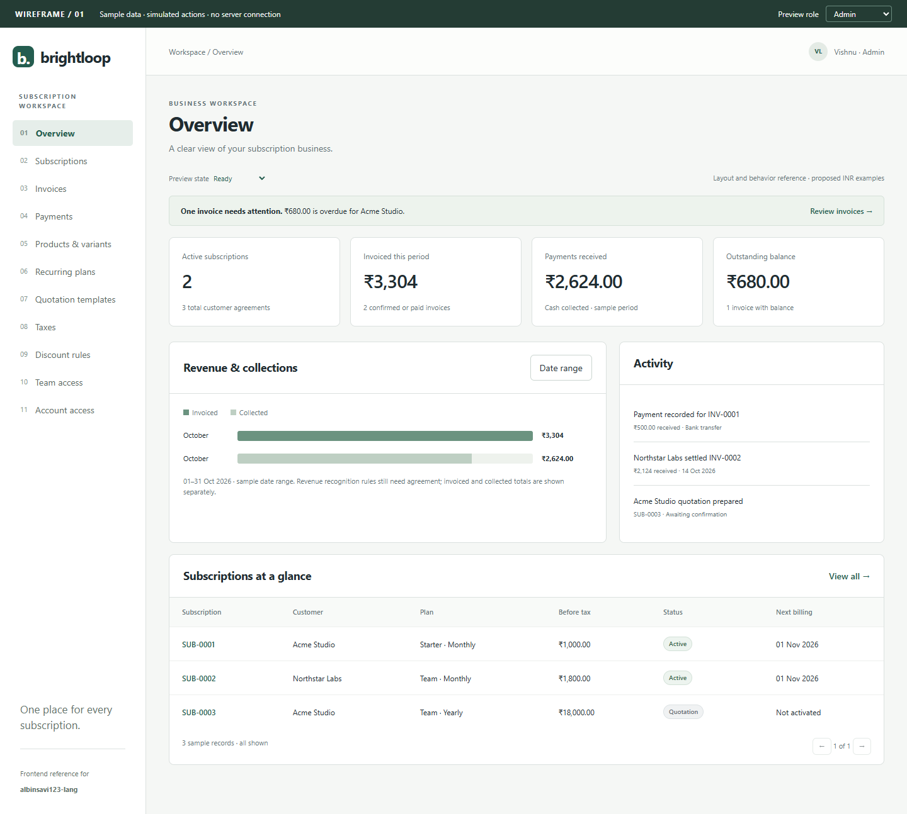

# Frontend wireframe and implementation handoff

Owner: **albinsavi123-lang**. Backend/contracts: **Vishnu912py**. Schema/fixtures: **Zenfox-690**.

## Open the wireframe

Open [wireframes/index.html](wireframes/index.html) in a browser after cloning the repository. It requires no install, build, server, or external assets. GitHub shows HTML source rather than running it; use the screenshot below for an immediate preview.

Also available: [customer portal at mobile width](wireframes/customer-mobile.png).

This is a responsive, clickable design reference, **not the production frontend**. It uses sample data, in-memory interactions and proposed INR amounts. It does not authenticate users, write records, send mail or enforce security. Role/state selectors are review tools and must not appear in production. Implement the real UI in React + TypeScript using agreed backend contracts; do not copy this prototype's rendering architecture as the production architecture.

## Walkthrough for Albin

1. Start in Admin / Overview. Review totals, overdue alert, summary chart and subscription table.
2. Open Subscriptions; search/filter records; open SUB-0001; preview pause/resume, renewal and add-on controls.
3. Open SUB-0003 to see the quotation, then confirm and activate it as staff/admin. This is a simulated state transition.
4. Open INV-0001. Record part or all of the remaining ₹680, then inspect its balance and the overview. Reload to reset all sample changes.
5. From Invoices, choose **Preview draft actions** to see confirm/cancel states on a separate example; this example is excluded from dashboard totals.
6. Visit product, plan, template, tax, discount and team screens; open their forms. Form saves generally show a preview message without modifying fixtures. Payment and lifecycle previews are the exceptions.
7. Switch to Customer to review Acme Studio's portal. Only Acme subscriptions/invoices are listed; admin settings and staff payment entry are absent.
8. Open Account access for sign-in, signup, forgot-password and reset-password layouts. Preview loading, empty, error and access-denied states with the state selector.

Date-range fields illustrate the future filtering UI; they do not filter the prototype's fixed October dataset. Sample pages use all rows on one page; production pagination must be server-backed. Print uses browser printing with navigation and prototype controls hidden.

## Screen map and required behavior

Routes below are **proposed React routes**, not implemented server endpoints. See [requirements](requirements.md) and [ER design](er-diagram.md) for source scope and fields.

| Screen / proposed route | Access | Main contents and actions | Requirements |
| --- | --- | --- | --- |
| `/login`, `/register` | Public | Email/password, inline errors, duplicate-email handling; password >=9 characters with uppercase/lowercase/special character | R01 |
| `/forgot-password`, `/reset-password` | Public with reset token where needed | Email request, neutral confirmation, new password, expired/used token state, return to login | R01 |
| `/app/overview` | Admin; staff if granted | Active subscriptions, invoiced totals, collections, balance, overdue list, date/plan filters | R11-R12 |
| `/app/products` | Admin | Name/type/sales price/cost/notes; variants and price adjustments; archive action, add-on configuration | R03 |
| `/app/plans` | Admin | Price/currency, recurrence, minimum quantity, availability, included products, auto-close/early-close/pause/renewal flags | R04 |
| `/app/templates` | Admin edits; staff uses | Plan, validity days, editable product lines/quantities/prices; create quotation from template | R05 |
| `/app/subscriptions` | Admin/staff | Search, status/plan/customer filters, new quotation, paginated agreements | R06 |
| `/app/subscriptions/:id` | Admin/staff | Customer, number, plan, dates, payment terms, lines/taxes/totals, lifecycle, history, permitted actions | R04-R06 |
| `/app/invoices` | Admin/staff | Number, customer, period, due date, total, balance, status, overdue indicator and filters | R07-R08, R10 |
| `/app/invoices/:id` | Admin/staff | Historical line/tax/discount amounts, confirm/cancel/send/print, payment history and payment entry | R08-R10 |
| `/app/payments` | Admin/staff with permission | Invoice, method, amount, date, note; record payment from invoice; prevent repeat submission | R10 |
| `/app/taxes` | Admin | Rule name, rate, product assignment, active/archive state | R08 |
| `/app/discounts` | Admin | Fixed/percentage, scope/targets, thresholds, dates, usage cap/consumption; archive | R09 |
| `/app/team` | Admin only | Add staff, staff list and access status; exact staff permission matrix agreed with Vishnu | R02 |
| `/portal` | Customer | Own subscription summary, next billing, outstanding balance and invoice links | R02, R11 |
| `/portal/subscriptions/:id` | Owning customer | Own details and permitted pause/resume/renewal/add-on actions; no administrative price/tax editing | R02, R04, R06 |
| `/portal/invoices/:id` | Owning customer | Own invoice totals/history, print view; no manual payment-entry or invoice lifecycle actions | R02, R08, R10 |

Some advanced states are specified here rather than fully simulated: backend validation errors, editing multiple product lines, actual report filtering, pagination, archive flows, reset token failure and historic cancellation/reversal rules. These remain implementation work, not completed features.

## Layout and reusable components

- App shell: 232px desktop sidebar, top breadcrumb/account header, spacious main content. On narrow screens, navigation scrolls horizontally in the wireframe; production may use an accessible drawer.
- Visual direction: restrained green, off-white background, thin borders and clear typography. This is a structural reference; no logo/brand approval is implied.
- Build `AppShell`, `PageHeader`, `StatCard`, `FilterBar`, `DataTable`, `StatusBadge`, `FormDialog`, `LineItemsEditor`, `MoneySummary`, `LifecycleStepper`, `ActivityTimeline`, `ConfirmDialog`, `EmptyState`, `ErrorState`, and `LoadingSkeleton`.
- Product/plan/template/subscription forms need reusable line editors supporting add/remove rows, product/variant selection, quantity, price, tax selection and server-calculated totals. The wireframe's simplified single-line forms show field placement only.
- Tables scroll within their containers on mobile. Form grids collapse to one column. Test at 390px, 768px and 1440px without page-level horizontal overflow.
- Use visible labels, keyboard navigation, clear focus styles, semantic headings and table headers. Dialogs trap focus and restore it to the opener; Escape closes them. Do not communicate status through color alone.

## Action/state rules

| Context | UI behavior |
| --- | --- |
| Subscription draft | Editable; save draft and prepare quotation after required-field validation |
| Quotation | Show valid-until date; staff confirms; expired quotes show a clear action/error agreed with backend |
| Confirmed subscription | Staff can activate when backend permits |
| Active subscription | Show next billing; pause/resume, renewal and early closure controlled by plan and role |
| Closed subscription | Show history; no new billing actions; renewal/reopening policy must be agreed |
| Paused subscription | Separate pause indicator alongside lifecycle status, not a new status enum |
| Draft invoice | Authorized staff confirms or cancels; payment entry unavailable |
| Confirmed invoice | Authorized staff sends/prints and records payment; cancellation allowed only under agreed business rules |
| Paid invoice | No payment button; preserve historical totals and payment history |
| Overdue invoice | Derived from due date and positive balance; separate indicator from invoice status |
| Cancelled invoice | Clearly labelled; no payment entry or silent regeneration; replacement policy is unresolved |
| Request pending | Disable repeated submit; preserve form values; expose progress without clearing the page |
| Request rejected | Field errors near inputs; form-level message for permission/conflict/server failure; preserve entered values |

The prototype's staff/customer permissions are proposed examples. Backend permission checks and customer ownership are mandatory on every request, including direct URL navigation and print/download access. The preview role switch is not an authorization mechanism.

## Data handoff with Vishnu and Zenfox

Use ER entity names consistently: subscription lines, invoice lines, tax snapshots, discount redemptions and payments. Agree on API shapes before wiring screens. Do not infer REST paths from the route table above.

For each screen ask the backend contract for record IDs, display values, status, allowed actions, pagination, available filters and validation errors. Examples of useful projections (not extra database tables): `customer_name`, `plan_name`, `amount_paid`, `balance_due`, `is_overdue`, `next_billing_date`, `can_pause`, `can_renew` and `can_record_payment`.

Money comes from backend calculations as exact decimal strings/minor units with a currency; format it for display. Calendar dates are distinct from timestamp events. Never recalculate official invoice totals with browser floating-point arithmetic. The prototype's numbers are fixtures only.

Sample reconciliation: INV-0001 subtotal 1,000 + tax 180 = 1,180; paid 500; balance 680. INV-0002 subtotal 1,800 + tax 324 = 2,124; paid 2,124. Overview: invoiced 3,304; collected 2,624; outstanding 680. Discount rules start in November and do not apply to these October invoice samples. Plan prices, tax rate and currency are design examples, not finalized business configuration.

## Suggested frontend PR sequence

1. `feat/ui-shell-auth`: React scaffold agreed with Vishnu, app shell, routing, account forms, shared state components.
2. `feat/ui-subscriptions`: subscription list/detail, quotation flow and line editor, starting with agreed fixtures.
3. `feat/ui-invoices-payments`: invoice list/detail/print, payment form, correct status and balance display.
4. `feat/ui-admin-configuration`: catalog, variants, plans, templates, taxes, discounts and admin staff management.
5. `feat/ui-portal-reporting`: customer ownership-filtered portal, reports, real filters and mobile polish.

Integrate real APIs as soon as each contract exists; do not wait until every screen is finished. PRs must identify mocks remaining, include desktop/mobile screenshots, and document a happy path plus one error/permission test. Page performance under two seconds with thousands of records is a later full-stack measurement, not something this static wireframe proves.

## Wireframe verification

Checked in a local headless Edge browser: 15 screen routes, seven configuration/form dialogs, search/no-results behavior, sample payment recording, quotation confirmation/activation, draft invoice confirmation/cancellation, role navigation, four page-state previews and signup password validation. Checked all screen routes at 390px, 768px and 1440px for page-level horizontal overflow; no browser script errors occurred. Desktop and mobile screenshots were visually reviewed. JavaScript syntax and documentation links passed checks. These checks verify the wireframe only, not production security, persistence, email delivery or application performance.
